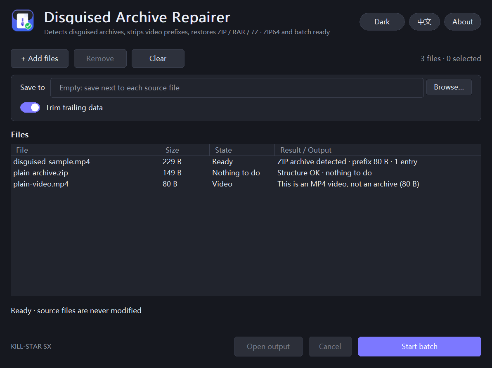

# Disguised Archive Repairer · Zip Repair Desk

[简体中文](README.md)

Some downloads have a ZIP, RAR, or 7Z archive appended to an MP4 while keeping the `.mp4` extension. A media player can still read the video, but an archive tool may not recognize the file.

Zip Repair Desk walks the MP4 box structure to find the join, then extracts the appended archive without changing the source file.



## Supported formats

| Format | Handling |
| --- | --- |
| ZIP / ZIP64 (including WinZip AES encryption) | Detect and extract |
| 7Z | Validate the structure, then extract |
| RAR5 | Validate the structure, then extract |
| RAR4 | Detect only; no automatic rewriting |
| CAB / ISO / GZIP / BZIP2 / XZ / ZSTD / TAR / ACE / ARJ / LZH | Detect only |
| MP4 / MKV / AVI / FLV / ASF / MPEG | Identify as video, not an archive |

## Features

- Drag and drop files or folders for batch processing, with cancellation support.
- Save beside each source file or in one output folder. Existing files are never overwritten.
- Optionally remove trailing data after the archive.
- Light and dark themes, Chinese and English interfaces; follows the system on first launch.
- Native Win32 + C++17, approximately 235 KB, with no separate runtime required.

## Usage

1. Run `ZipRepairDesk.exe`. Administrator rights are not required.
2. Drop files or folders into the window, or click **Add files**.
3. Check that the items are marked **Ready**, then click **Start batch**.
4. Click **Open output** when processing finishes.

Plain videos, valid ZIP files, and detection-only formats are marked **Video**, **Nothing to do**, or **Unsupported**. No extra copies are created for them.

### Windows security prompt after downloading

An EXE downloaded through a browser or messaging app may carry a Mark of the Web, so Windows can show an **Open File - Security Warning** once. This is unrelated to UAC elevation. The publisher should be **KILL-STAR SX**.

Right-click the file, open **Properties**, and select **Unblock**, or run:

```powershell
Unblock-File .\ZipRepairDesk.exe
```

Local builds and files signed with `sign.ps1` have this marker removed automatically.

## Build from source

Install a MinGW-w64 toolchain (`g++`, `windres`, and `objcopy`), such as [w64devkit](https://github.com/skeeto/w64devkit). In PowerShell 5 or later:

```powershell
# Omit -Toolchain when the toolchain is on PATH or W64DEVKIT is set
.\build.ps1 -Toolchain C:\path\to\w64devkit
```

The executable is written to `dist\ZipRepairDesk.exe`. Add `-WithCli` to build the command-line version as well.

The build uses `-Oz`, section garbage collection, and static linking. `objcopy` anchors the resource section so `--gc-sections` does not discard it.

## Code signing and certificates

Release binaries are signed with the KILL-STAR SX code-signing certificate using SHA256. The certificate chain is shared with Jpg-Raw-Pair-Cleaner:

- Root certificate: `certs\KILL-STAR SX Root CA.cer`. Install it under the current user's **Trusted Root Certification Authorities**.
- Leaf certificate: CN=KILL-STAR SX, issued by that root. Development machines can also install it under **Trusted Publishers**.
- The same certificate pair can sign all KILL-STAR SX software. Install the root certificate once per Windows user.

See [certs/README.txt](certs/README.txt) for installation steps. After rebuilding, sign with your local certificate:

```powershell
.\sign.ps1 -Thumbprint <certificate-thumbprint>
```

The script uses SHA256 and verifies `Status -eq "Valid"`. Re-sign after every build. Signing identifies the publisher, but does not guarantee that SmartScreen or antivirus software will allow the file.

## Tests

```powershell
python tests\run_tests.py         # ZIP / ZIP64, batches, trimming, unique names, CRC, source integrity
python tests\test_formats.py      # MP4+7Z, MP4+RAR5, RAR4 detection, video detection
python tests\gui_smoke.py         # Drive the real window through one conversion and verify CRC
python tests\capture_previews.py  # Recapture the Chinese and English previews
```

## License

[Apache License 2.0](LICENSE). Copyright © 2026 KILL-STAR SX.
