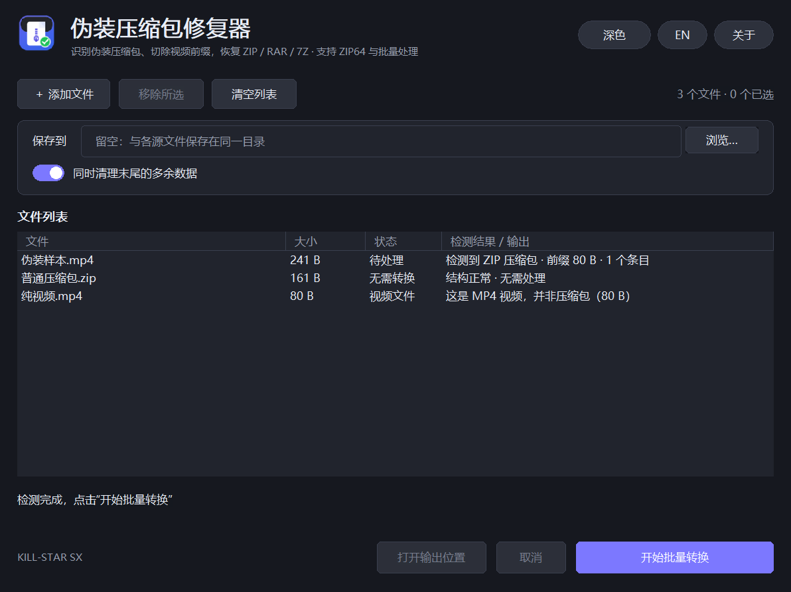

# 伪装压缩包修复器 · Zip Repair Desk

[English](README.en.md)

有些资源把 ZIP、RAR 或 7Z 接在 MP4 后面，再保留 `.mp4` 后缀。播放器还能读视频，解压软件却未必认得出。

这个工具按 MP4 容器结构找到拼接位置，把后面的压缩包完整切出来。源文件不会被改动。



## 支持格式

| 格式 | 处理方式 |
| --- | --- |
| ZIP / ZIP64（含 WinZip AES 加密） | 识别并切片修复 |
| 7Z | 校验结构后切片修复 |
| RAR5 | 校验结构后切片修复 |
| RAR4 | 只识别，不自动改写 |
| CAB / ISO / GZIP / BZIP2 / XZ / ZSTD / TAR / ACE / ARJ / LZH | 只识别 |
| MP4 / MKV / AVI / FLV / ASF / MPEG | 识别为视频，提示并非压缩包 |

## 功能

- 批量拖放文件或文件夹，后台处理，可随时取消。
- 输出到源文件旁边或统一目录；同名文件自动加后缀，不覆盖已有文件。
- 可选清理压缩包末尾的多余数据。
- 浅色 / 深色主题，中文 / 英文界面；首次启动跟随系统设置。
- 原生 Win32 + C++17，单文件约 235 KB，无需另装运行时。

## 使用方法

1. 双击 `ZipRepairDesk.exe`，不需要管理员权限。
2. 把文件或文件夹拖进窗口，也可以点“添加文件”。
3. 确认状态为“待处理”，点“开始批量转换”。
4. 完成后点“打开输出位置”。

普通视频、无需修复的 ZIP 和仅支持识别的格式，分别显示“视频文件”“无需转换”“暂不支持”，不会生成多余副本。

### 下载后出现安全提示

浏览器或聊天软件下载的 EXE 可能带有“来自 Internet”标记，Windows 因此会显示一次“打开文件 - 安全警告”。这与 UAC 管理员权限无关，发行商应显示为 **KILL-STAR SX**。

可以右键文件，打开“属性”并选择“解除锁定”，也可以在 PowerShell 中执行：

```powershell
Unblock-File .\ZipRepairDesk.exe
```

源码构建和 `sign.ps1` 签名后的本机文件会自动清除这个标记。

## 从源码构建

准备 MinGW-w64 工具链（`g++`、`windres`、`objcopy`），例如 [w64devkit](https://github.com/skeeto/w64devkit)。在 PowerShell 5 或更高版本中运行：

```powershell
# 工具链已加入 PATH，或设置过 W64DEVKIT 时，可省略 -Toolchain
.\build.ps1 -Toolchain C:\path\to\w64devkit
```

产物位于 `dist\ZipRepairDesk.exe`。加 `-WithCli` 会额外构建命令行版。

构建使用 `-Oz`、段回收和静态链接；资源节通过 `objcopy` 锚定，避免被 `--gc-sections` 回收。

## 代码签名与证书

发布包使用 KILL-STAR SX 代码签名证书（SHA256），证书体系与 Jpg-Raw-Pair-Cleaner 相同：

- 根证书：`certs\KILL-STAR SX Root CA.cer`，安装到当前用户的“受信任的根证书颁发机构”。
- 叶证书：CN=KILL-STAR SX，由上述根证书签发；开发机可安装到“受信任的发布者”。
- 同一套证书可用于所有 KILL-STAR SX 软件，每台电脑、每个用户安装一次根证书即可。

安装步骤见 [certs/README.txt](certs/README.txt)。重新构建后，用本机证书签名：

```powershell
.\sign.ps1 -Thumbprint <证书指纹>
```

脚本使用 SHA256，并检查 `Status -eq "Valid"`。每次重新构建都要重新签名。签名可以标明发布者，但不能保证 SmartScreen 或杀毒软件一定放行。

## 测试

```powershell
python tests\run_tests.py         # ZIP / ZIP64、批量、尾部清理、唯一命名、CRC、源文件不变
python tests\test_formats.py      # MP4+7Z、MP4+RAR5、RAR4 只识别、视频判定
python tests\gui_smoke.py         # 操作真实窗口完成一次转换并校验 CRC
python tests\capture_previews.py  # 重新截取中英文界面预览
```

## 许可证

[Apache License 2.0](LICENSE)。Copyright © 2026 KILL-STAR SX。
